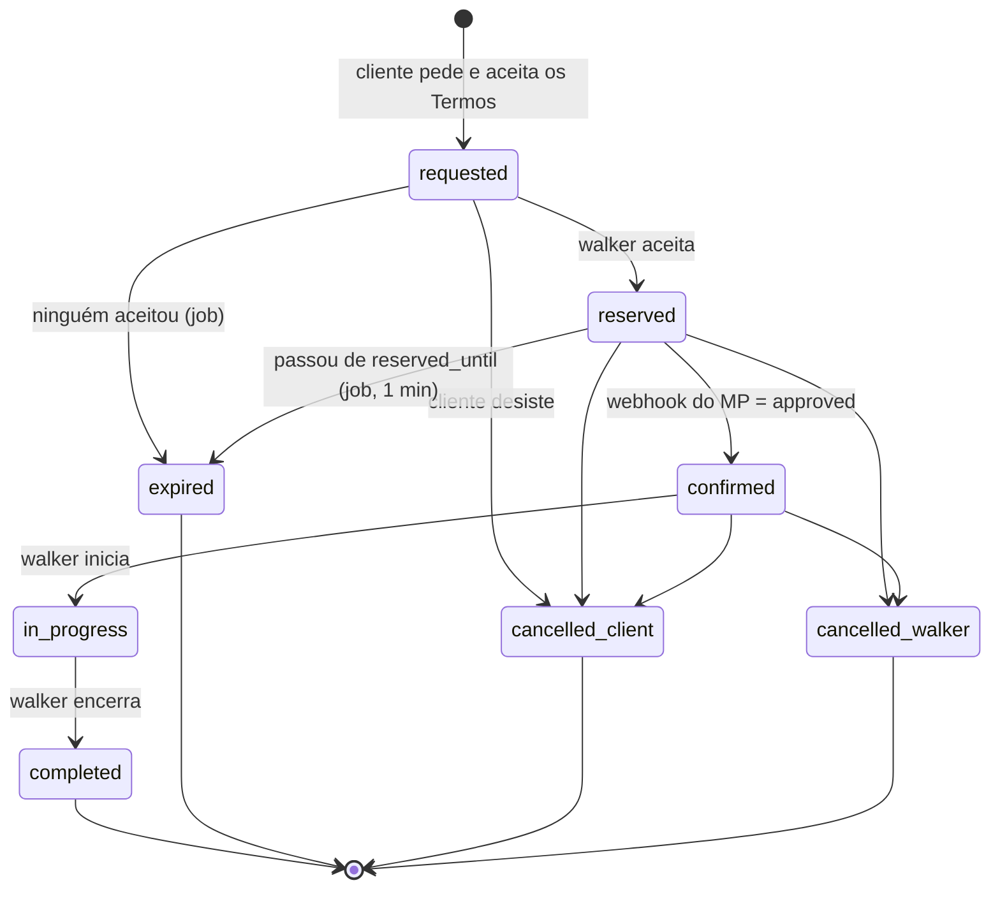

# Máquina de estados do serviço

Fonte da verdade: `service_requests.status`. As transições são validadas pelo trigger
`assert_status_transition()` no banco — o app não pode inventar um caminho novo.

---

## Diagrama



---

## Os estados, um a um

| Estado | O que significa | Quem faz sair daqui |
|---|---|---|
| `requested` | Pedido criado, Termos aceitos, preço congelado. Visível aos walkers do raio. | walker, cliente ou job |
| `reserved` | Um walker assumiu. `reserved_until` = agora + 10 min. | webhook do PIX ou job |
| `confirmed` | Pagamento aprovado. O serviço vai acontecer. | walker |
| `in_progress` | Walker iniciou. | walker |
| `completed` | Encerrado. Libera avaliação e repasse. | — final |
| `expired` | Ninguém pagou no prazo. Walker volta ao pool. | — final |
| `cancelled_client` | Cliente cancelou. Reembolso pela tabela. | — final |
| `cancelled_walker` | Walker cancelou. Cliente recebe 100%. | — final |

Os quatro últimos são **finais**: qualquer update de status a partir deles levanta exceção.

---

## Quem pode disparar o quê

| Transição | Autorizado | Onde roda |
|---|---|---|
| → `requested` | cliente | app (RLS: `client_id = auth.uid()`) |
| → `reserved` | walker | app (RLS: `walker_id = auth.uid()`) |
| → `confirmed` | **ninguém no app** | Edge Function do webhook, `service_role` |
| → `in_progress` | walker | app |
| → `completed` | walker | app |
| → `expired` | **ninguém** | `expire_stale_reservations()`, pg_cron |
| → `cancelled_*` | cliente ou walker | app, gravando o split |

> `confirmed` nunca pode ser disparado pelo app. Se fosse, qualquer um confirmaria um
> serviço sem pagar.

---

## Carimbos automáticos

O trigger preenche sozinho, sem o app mandar:

```
reserved     → accepted_at, reserved_until (+10 min)
confirmed    → confirmed_at
in_progress  → started_at
completed    → completed_at, final_payout_cents
expired      → cancelled_at
cancelled_*  → cancelled_at
```

---

## A parte que quebra sozinha

**`expire_stale_reservations()` precisa estar agendada no pg_cron, a cada minuto.**

Sem isso, nada dá erro visível: reservas ficam presas em `reserved` para sempre, o walker
continua marcado como ocupado, os pedidos param de encontrar quem os atenda e o app parece
"vazio". É o bug mais caro de diagnosticar do sistema inteiro.

```sql
select cron.schedule(
  'expira-reservas',
  '* * * * *',
  $$ select expire_stale_reservations() $$
);
```

Colocar um alerta: se `count(*) where status='reserved' and reserved_until < now()` for
maior que zero por mais de 2 minutos, o job morreu.

---

## Notificações por transição (Épico 6)

| Transição | Quem recebe | Mensagem |
|---|---|---|
| → `reserved` | cliente | "Fulano aceitou. Pague em 10 minutos para confirmar." |
| → `confirmed` | walker | "Pagamento confirmado. O serviço está garantido." |
| → `expired` | ambos | "A reserva expirou por falta de pagamento." |
| → `in_progress` | cliente | "O passeio começou." / "O walker chegou." |
| → `completed` | cliente | "Serviço concluído. Que tal avaliar?" |
| → `cancelled_*` | a outra parte | "Serviço cancelado." + valor do reembolso |

---

## Casos de borda já resolvidos

**Cliente paga depois de expirar.** O webhook chega e a transição `expired → confirmed` é
inválida: o trigger levanta exceção. A Edge Function trata isso estornando o pagamento e
avisando o cliente. **Este caminho precisa de teste automatizado** — é raro e caro.

**Dois walkers aceitam ao mesmo tempo.** O update de `requested → reserved` deve rodar com
`where status = 'requested'`; quem chegar em segundo lugar afeta 0 linhas e recebe "outro
walker já assumiu".

**Webhook duplicado.** O Mercado Pago reenvia o mesmo evento. O índice único de
`mp_payment_id` e o de um aprovado por solicitação barram no banco, não no código.

**Walker cancela com o serviço já em andamento.** Não existe: `in_progress` só vai para
`completed`. Abandono em andamento é incidente operacional, tratado por suporte e pelos
Termos, seção 11 — não por mudança de estado.
